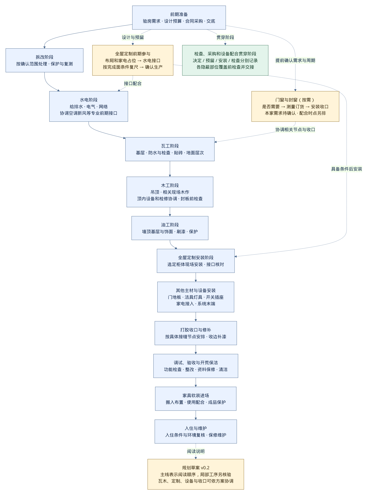

# 装修阶段、工种衔接与提前预留

版本：0.2；日期：2026-10-13；适用档案：`home-xian-156` revision 3。

**按“拆改、水电、瓦工、木工、油工、安装收尾”等名称看进度；每个项目同时记录“何时决定、何时预留、何时安装、何时检查”。**

这是项目组织方案与待核验的工序草案，可以用于安排资料收集、设计沟通和问题检查。采用业主提出的工种名称作为阅读入口，具体工序与本家适用性仍需按设计和现场条件核验。名称与分组属于本项目的组织选择，不代表全国统一的阶段标准。

调研过程见[搜索与核验记录](12-stage-research.md)，结论 ID 见[阶段规划结论](../knowledge/stage-planning-claims.json)，依据位置见[参考证据索引](../evidence/stage-planning-references.json)。

## 先看这张阶段表

表格按阅读主线排列，回答“现在轮到谁、在做什么”。阶段工作是规划范围，关联 `P-STAGE-08`；局部顺序、验收方法和接口参数待核验。门窗、定制、采购与检查都可能跨阶段。

| 阶段 | 主要看什么 | 需要提前配合的事项 |
| --- | --- | --- |
| 前期准备 | 验房量房、家庭需求、布局设计、预算合同、开工手续与交底 | 家具家电占位、系统选型、完成面基准、预留清单和采购周期 |
| 拆改阶段 | 经确认范围内的拆除、铲除、空间调整与拆后复测 | 查清结构与原有管线保护边界；供暖保留或重做等影响拆除的事项先确认 |
| 门窗与封窗阶段（按需） | 是否换窗或封窗、测量订货、安装、节点处理与保护 | 与拆改、窗台和墙面收口配合；本家尚未确认换窗或封阳台，不默认安排 |
| 水电阶段 | 给排水、电气、网络布管布线；与空调、新风等专业协调设备前期接口 | 插座、给排水、控制、设备与柜体位置先确认；相应隐蔽部位验收后交接 |
| 瓦工阶段（防水、贴砖等） | 基层、防水及相应检查、墙地砖、地面基层等 | 地面构造与标高、地漏及穿管节点、门窗与柜体完成面；供暖施工分支另排 |
| 木工阶段（吊顶等） | 吊顶、相关现场木作、支撑、检修口与封板 | 顶内设备、风口、灯位、窗帘与柜体位置；封板前检查相关隐蔽部位 |
| 油工阶段（墙顶饰面、刷漆） | 基层处理、涂饰与分项检查 | 按材料体系确认施工条件；与门柜安装、交叉施工和后续补漆协调 |
| 全屋定制安装阶段 | 橱柜、衣柜及其他选定柜体的现场安装与接口核对 | 设计、初测和水电配合在前期进行；生产前复尺，安装前核对现场条件 |
| 其他主材与设备安装阶段 | 门、地板、台面、成品厨卫吊顶、洁具、开关插座、灯具、家电及系统末端等 | 与定制安装可能交叉；按具体构造、接口和保护条件排各项先后 |
| 打胶收口与修补阶段 | 按选定节点处理接缝、收边及安装后的损伤修补 | 各自需要的收口随相应安装安排；不默认“全屋打一遍胶”，不把接电或设备接入归为打胶作业 |
| 调试、验收与开荒保洁 | 单机/系统功能、缺陷整改、工程验收、资料保修交接与清洁 | 检查贯穿各阶段；室内环境检查的对象、条件和时点另核对，不用保洁代替验收 |
| 家具软装进场 | 成品家具、窗帘和其他软装的搬入、摆放与使用配合 | 大件尺寸、搬运路线和电源点位前期考虑；保护已完成项目，复核新增问题 |
| 入住与维护 | 入住前条件复核、使用问题、保修返修和维护 | 家具软装加入后的室内环境与使用条件仍需考虑；不凭固定通风天数判断入住 |

这里的“木工”包含相关现场木作；“全屋定制安装”主要指选定柜体的后期安装。柜体是否现场制作、工厂加工或采用其他形式，由实际方案决定。

## 三个跨阶段项目怎样理解

**门窗与封窗**单独设置阅读入口。它包含是否需要、测量、订货、安装和收口，不能从表格位置推断为“所有房屋都在拆改后、水电前一次性做完”。本家的窗户条件与是否更换仍待确认。

**全屋定制**从前期就参与：布局和家电占位 → 水电接口配合 → 按完成面条件复尺 → 确认生产 → 现场安装 → 收口检查。每个节点的实际前提由设计和供应方核对。表中的后期阶段特意叫“全屋定制安装”，以免把柜体规划拖到安装时才开始。

**安装与收尾**可以作为一个大类阅读，下分定制安装、其他主材与设备安装、打胶收口与修补、调试检查。插座安装、电器接入属于对应的安装工作；打胶属于具体接缝节点的处理，需要按材料、构造与作业条件安排。前后顺序不由“最后收尾”四个字统一决定。

阶段检查贯穿水电、防水、木工封板等相应节点，竣工检查另行保留。空调、新风、供暖、净水、热水、网络和智能家居在[提前预留清单](#本家的提前预留清单)中跟踪前期配合与后期调试；不因设置一个“水电阶段”就把所有专业工作都交给水电工。

## 三条时间线

| 时间线 | 记录内容 | 举例：洗碗机 |
| --- | --- | --- |
| 决策与设计 | 是否需要、放在哪里、尺寸范围、接口依据、最晚确认节点 | 布局和接口在水电交底前核对；依赖具体型号的参数待厂家文件确认 |
| 采购与加工 | 资料取得、订货、复尺、生产、到货、运输与保管条件 | 安装前到货，但参数文件可能在前期就需要；到货日期另排 |
| 施工与检查 | 预留、隐蔽检查、成品安装、调试与交接 | 先预留接口，后配合橱柜安装和通水通电检查 |

上述例子属于待核验的规划提示 `P-STAGE-04`，不是已确定的产品安装方案。**提前取得参数不等于必须提前买齐所有设备。** 型号未定时可以比较方案；若候选设备的接口不能相互兼容，相关预留就保持未锁定，不填“通用尺寸”。

## 工作步骤与交接记录

业主阅读使用上面的工种阶段；`S00—S12` 保留为详细工作步骤编号，方便追踪原有记录。原有 `00—09` 分类作为资料标签保留，映射见后文。全表关联 `P-STAGE-01 / P-STAGE-02 / P-STAGE-03`；具体技术合格标准由适用依据、设计和专业人员确定。

展开详细任务、交付物与交接条件

| 步骤 | 做什么 | 应交付什么 | 推进前要确认什么 |
| --- | --- | --- | --- |
| S00 房屋核查与需求 | 核对交付缺陷、图纸、现场尺寸、原有管线和设备条件；梳理房间用途、长期居住需求及预算口径 | 房屋问题清单、测量记录、需求清单、未知条件台账 | 影响拆改和系统设计的未知项有明确核查责任；交付问题与装修问题分开 |
| S01 整体方案与接口设计 | 空间布局、柜体与家电占位；水电、供暖、空调、新风、净水、热水、网络等一起讨论 | 平面布局、设备清单、管线综合图、完成面基准、预留清单、方案取舍 | 不能只看效果图；相关项目的可行性、接口冲突与检修条件有处理结果 |
| S02 团队、报价、合同与采购计划 | 明确设计施工边界、工程量口径、各供应商责任、变更与付款规则、订货周期 | 范围与报价对照、合同、阶段检查与采购计划 | 拆除、修复、检测、搬运、垃圾清运、设备配合等包含项明确 |
| S03 开工准备与交底 | 核对物业要求、现场保护、图纸版本、施工与检查安排；相关人员现场交底 | 开工资料、保护记录、交底记录、版本一致的图纸 | 相关手续和开工条件落实；影响当前作业的未决事项不带入施工 |
| S04 经确认的拆除、空间调整与基层核查 | 按已确认范围处理交付表层与原管线；如需空间调整，先确认可实施边界；拆后复测 | 拆改范围记录、基层现状、复测结果、需修订的方案 | 结构与原有设施保护得到专业确认；铲除深度、供暖保留范围等不是工人临场猜测 |
| S05 隐蔽管线与设备前期安装 | 根据图纸实施给排水、电气、网络及选定系统的前期工程；核对点位与安装空间 | 管线与接口记录、实际点位、设备前期检查资料 | 系统之间的路线、标高、空间与接口已协调；试验内容和方法有依据 |
| S06 分项隐蔽检查与交接 | 对即将被覆盖的部位逐项检查、试验、留存定位和整改记录 | 对应部位的验收文件、影像、实测定位、整改闭环 | **未验收合格的相应隐蔽部位不覆盖**；逐部位执行，不等到最后一次性补签 |
| S07 基层、防水与湿作业 | 按设计落实基层修补、防水、相关试验、铺贴和地面基层等；逐节点交接 | 分项检查记录、材料与工法记录、完成面实测、养护与保护安排 | 防水与穿管节点、地面层次、供暖处理分支和覆盖条件明确；具体顺序待工法核验 |
| S08 吊顶、木作与封板 | 配合顶部设备、灯具、窗帘等确定构造、支撑与检修；相关隐蔽检查后封板 | 封板前检查记录、吊顶与开口尺寸、支撑和检修位置 | 顶内相关管线和设备已完成该时点所需检查；风口、灯位、柜体和窗帘位置相容 |
| S09 墙顶表面与涂饰 | 按材料体系处理基层和饰面；协调交叉工序、干燥与成品保护 | 材料与施工记录、表面分项检查、后续安装与修补计划 | 基层和环境条件符合选定体系；不凭固定天数替代条件检查 |
| S10 成品与设备安装 | 按接口和成品保护安排门、柜、地板、台面、洁具、开关灯具、家电及系统末端 | 安装记录、接口核对、设备资料、损伤与整改清单 | 量尺、生产、交付和安装条件一致；内部顺序依产品构造及收口确定 |
| S11 系统调试、竣工检查与交接 | 核对单机与系统使用功能、缺陷整改、工程与室内环境检查、资料交接 | 调试/检测与验收记录、竣工图、保修与维护资料 | 检查对象、方法与适用依据明确；“看起来装好了”不替代使用功能与环境检查 |
| S12 入住准备与使用维护 | 按前述结果安排保洁、家具软装和入住；记录使用问题、维护与返修 | 入住问题清单、维护计划、保修联系与变更记录 | 入住判断所需资料落实；不设没有依据的统一通风或入住天数 |

S01 与 S02 可以迭代推进；采购贯穿多个阶段。S06 是每个覆盖动作前都要重复的交接节点。S07 与 S08 是否可以交叉作业，应由现场组织、污染与成品保护条件确认；表格编号不代表所有房间必须同步完成一个阶段才能开始下一个。

## 哪些顺序可以先作为规划约束

**有已读条文支持的控制原则**：施工前进行设计与技术交底；工序自检与专业工种交接留下记录；隐蔽前验收并保留影像和文件，合格后再继续。对应 `P-STAGE-02`；已核对原文，不等于已经完成该标准的现行状态和本家适用性核验。

**本项目的决策依赖草案**：布局与设备接口确认 → 相应预留施工 → 相应隐蔽检查 → 覆盖或封板 → 成品安装 → 使用功能检查。对应 `P-STAGE-03 / P-STAGE-04`。实际项目应拆到房间、系统和部位；前序变化时复核下游记录。

**需要按条件安排的工序**：门窗更换、供暖保留或重做、地面层次、防水与相关管线节点、泥木交叉、门柜地板的收口、厨卫吊顶与设备配合。对应 `P-STAGE-05`。不能把某篇文章的“先瓦工后木工”扩大成适合所有工法的规则。

**持续进行的工作**：图纸变更、采购、材料到货检查、现场记录、分项检查和成品保护，贯穿对应阶段。

[PNG 原图](assets/renovation-stages.png) · [Mermaid 源码](assets/renovation-stages.mmd)。白底、4 倍渲染；图中为规划关系，不是已核定工期或施工组织图。

## 本家的提前预留清单

下表全部是**待设计与核验的接口问题**，关联 `P-STAGE-04 / P-STAGE-06`。依据本家已登记需求提出，不从搜索摘要或未指定仓库提取施工建议。未给出插座高度、管径、线径、孔径、坡度、试验压力或设备容量；这些数值须有具体依据。

“最晚节点”指影响相关工作的确认节点，实际日期未定。确认人表示拟参与责任，不表示这些人员已经聘请。

| 项目 | 方案阶段要问清什么 | 相应作业前要锁定或检查什么 | 后期安装与复核 | 拟参与确认人 |
| --- | --- | --- | --- | --- |
| 整体电路更换 | 本户可改造边界、入户与配电条件、设备负荷、回路及控制需求 | 电气交底前锁定有依据的方案与点位；封槽或封板前检查 | 末端安装、用电与控制功能检查；不得仅凭开关亮灯判断整项合格 | 电气设计/施工、业主 |
| 整体水路更换 | 冷热水等范围、排水是否包含、原接口与水压条件 | 给排水交底前明确范围、路线、点位及试验方案；覆盖前检查 | 接设备后核对通水、排水和漏水检查条件 | 给排水设计/施工、业主 |
| 供暖保留或重做 | 四路的实际类型、覆盖、运行与设计资料；保留、调整、重铺的同范围比较 | 涉及供暖或地面拆除前先确认保护边界；地面层次施工前确定选定分支 | 按选定系统安排过程检查及具备供暖条件时的复核 | 供暖专业、物业/供热方、业主 |
| 中央空调与新风 | 外机位条件；设备位置、管路、可能的排水、风口、噪声与检修；顶面综合布局 | 相关孔洞、管线和吊顶施工前核对型号/方案依据与占位；封板前检查 | 配合风口与控制末端安装、调试；开孔条件单独专业核查 | 暖通、设计、施工、设备方 |
| 入户过滤、中央净水/软水候选 | 设备组合、水质水压、位置、维护空间；各设备是否需要电源和排水 | 相应给排水预留前取得选定设备接口资料；未选中央净水/软水不默认施工 | 安装、调试与维护交接；按实际配置复核 | 给排水、设备方、业主 |
| 燃气热水器与零冷水候选 | 合法安装位置、供气与排烟条件；是否采用循环方案、所需管路和控制 | 涉及热水布管前确定是否采用该方案及接口依据；燃气事项由相应专业确认 | 安装、调试及燃气方所需检查；拒绝电热水器的偏好保持 | 燃气方、给排水、设备方、业主 |
| 洗衣机与烘干机 | 并排或叠放等候选布局、实际设备尺寸、门扇/抽屉活动与维护 | 水电交底和柜体接口确认前取得对应资料；不预设所有烘干机都有相同接口 | 柜体和设备配合安装、运行检查 | 设备方、柜体方、水电、业主 |
| 冰箱、洗碗机与厨房设备 | 柜内外布置、机体和开门空间；电源及适用的给排水、散热维护条件 | 水电定位前确认设备与橱柜接口；柜体生产前依据完成面复尺 | 按厨房安装方案复核台面、柜门、接口与功能 | 厨房设计、柜体/设备方、水电 |
| 终端净水设备 | 设备、储水/龙头等实际组成和位置；适用的电源、给排水与耗材更换条件 | 厨房水电与柜体交底前锁定实际设备接口；台面开孔前再核对 | 安装、通水与维护条件检查 | 净水/柜体方、水电、业主 |
| 自动洗地拖地机器人 | 基站位置、机体进出、维护操作；自动上下水资料 | 对应水电预留前取得实际型号资料；柜体生产前核对净空 | 基站接入、进出与自动上下水功能检查 | 设备/柜体方、水电、业主 |
| 自动洗地机 | 先确认设备形态；作为独立项目确认自动上下水可实现条件 | 不与机器人合并点位；对应预留前取得其自身接口资料 | 独立安装与功能检查 | 设备方、水电、业主 |
| 全屋网络、智能家居、NAS与监控 | 设备接入方式、集中位置、AP/网关与摄像头候选点位、供电散热；FTTR是否预留 | 对应布管、布线和顶面封板前确定方案；智能开关所需接口依实际产品核对 | 布线与设备接入、覆盖和场景功能检查；室外条件另核查 | 网络/智能设计、电气、物业、业主 |
| 门窗、门与柜体 | 是否更换、初测；门洞、开启、墙地完成面和柜体占位 | 相关基层/收口前确认接口；生产前按供应方要求复尺；更换窗的顺序单独排 | 安装、固定、密封、收口与活动空间复核 | 设计、门窗/柜体方、施工 |
| 地砖、木地板与地面构造 | 选定体系厚度、标高基准、区域衔接、供暖适配 | 相关地面基层施工前核对构造；门和柜体复尺使用同一完成面基准 | 铺装与交叉安装顺序由构造和保护条件确定 | 设计、地面/门柜方、施工 |
| 灯光、窗帘及未来变化 | 灯位、控制、窗帘形式；儿童成长与长辈阶段性居住是否产生点位变化 | 相关布线和吊顶交底前确认电源、开口与必要支撑依据 | 末端安装、遮挡与活动空间、使用场景复核 | 设计、智能/灯具/窗帘方、业主 |

装修意向与工程设计分开：不因“一个外机位”就断言中央空调是唯一可行方案；不因“四路暖通”判断供暖能力；不替业主选定软水、FTTR、大循环零冷水或供暖重铺。

## 怎样记录一个预留项

使用[阶段与预留模板](../templates/stage-reservation.md)。尺寸、点位不能只有一串数字，至少说明：

- 对象与位置：房间、设备/系统、接口用途和与哪个柜体/构造配合。
- 测量基准：相对完成地面、完成墙面或明确的基准轴线；注明单位、净尺寸、开口尺寸及标高含义。
- 参数来源：产品安装文件版本和位置、设计图版本、现场测量；未知参数留空。
- 四个时点：决定、预留、安装、检查；另列订货与复尺节点。
- 状态与责任：待确认、已锁定、已施工、已检查分别记录；技术核验与本家适用性另列。
- 影响范围：变更后需要复核哪些管线、柜体、吊顶、墙地面与检查记录。

最晚节点到了但关键参数仍未知时，相应作业保持待确认；不以“以后安装时再说”填补接口缺口。这是项目交接规则，关联 `P-STAGE-03 / P-STAGE-04`。

## 与已有分类和工作编号的映射

阅读入口采用工种名称，已存在的资料编号继续保留。门窗与定制等项目可以关联多行，不能被一个目录位置限制为单次进场。

| 已有分类标签 | 对应工作步骤 | 业主阅读入口 |
| --- | --- | --- |
| 00 房屋与需求 | S00 | 前期准备 |
| 01 方案与预算 | S01，关联 S02 | 前期准备；各安装项目的设计与预留 |
| 02 团队与合同 | S02 | 前期准备 |
| 03 开工准备 | S03—S04 | 前期准备、拆改；门窗的相关配合 |
| 04 隐蔽工程 | S05—S06及后续隐蔽交接 | 水电、设备前期配合、各阶段覆盖前检查 |
| 05 防水与湿作业 | S07 | 瓦工；门窗与地面节点的相关配合 |
| 06 木作与表面 | S08—S09 | 木工、油工 |
| 07 安装与调试 | S10—S11；前期关联 S01/S05 | 定制安装、其他主材设备安装、打胶修补、调试 |
| 08 竣工与入住 | S11—S12的验收与入住准备 | 验收保洁、家具软装、入住 |
| 09 使用与维护 | S12的维护与反馈 | 入住与维护 |

未来分析文章时，除主题和学习分类，再注明关联工作步骤、前置条件、最晚确认节点、接口问题和证据状态。这样某设备的文章即使归在“安装”，其前置问题也会出现在“方案”和“隐蔽工程”的清单中。

## 版本记录

| 版本 | 日期 | 调整 |
| --- | --- | --- |
| 0.1 | 2026-10-13 | 建立工作步骤、交接条件与提前预留清单 |
| 0.2 | 2026-10-13 | 根据业主反馈以工种名称作为阅读入口；补充门窗、定制安装与安装收尾的跨阶段说明，保留既有编号 |

## 当前先推进的工作

1. 用 S00 收集户型与现场资料，查清结构边界、原水电、四路暖通和外机位等；敏感图纸放在 `local/`。
2. 用 S01 形成房间用途、家具家电占位、系统接口与完成面基准的第一版清单，未知项明确保留。
3. 从[搜索候选](12-stage-research.md)中指定少量经验仓库和路径，固定提交后读取，与官方依据分别对照。
4. 将真实结论补入主题知识与相应工作步骤；接口有产品/设计依据后，再形成具体预留和检查要求。

阶段框架可以作为当前组织版本使用；实际开工、技术合格标准、工期和采购订单尚未确定。
