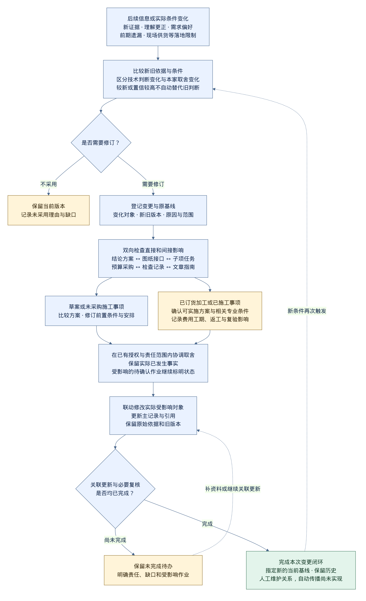

# 允许回改与关联更新

日期：2026-10-13；规则：`RULE-REVISION-01`；依据：用户明确提出后续更可靠、更合适的信息，以及需求和落地条件变化，可以优化前面的内容，并同步修改受影响对象。

**项目允许在任意阶段回改前面的整理、结论、材料、工艺、流程和方案。每次修订都说明原因，保留旧版本，检查关联影响，更新后形成新的当前基线。** 此规则已采用；本页定义记录与工作方式，自动影响传播、数据库关系查询和通知尚未实现。

用户指令与采用记录对应 `P-STAGE-10`，见[阶段规划记录](../knowledge/stage-planning-claims.json)；它核验的是项目规则的采用，不是具体工程方案。

## 两个独立的判断

| 判断 | 需要确认什么 | 修订可能怎样发生 |
| --- | --- | --- |
| 信息是否可靠、判断是否有依据 | 是否取得原文、准确定位、条件完整、标准/产品版本合适；支持与反对证据是否匹配问题 | 更正理解、补条件、修正参数、撤回无依据结论或重新核验 |
| 方案是否适合本家、能否落地 | 当前需求、现场、预算、采购、施工配合、维护与使用条件 | 原结论可保持成立，但本家改选方案、调整范围、取消或延期 |

不按“更晚发布”、来源数量、热度或 AI 的置信分数自动替换旧判断。后续信息只有在证据、条件或实际可行性方面给出充分理由，才推动相应修订。新旧方案未分出结果时保留比较和缺口。

主观因素如偏好、用途和成本接受程度可以触发方案比较；客观因素如实际尺寸、供货、专业核查结果或施工条件可以触发范围调整。实际预算等未提供数据仍留空。偏好与取舍变化不把技术事实改写成相反事实，也不使不符合适用要求的方案获得采用条件。

## 可以改哪些内容

覆盖来源的理解与清洗结果、独立结论、材料和产品选择、工艺与阶段安排、房屋需求、候选和已选方案、图纸、接口预留、工程量报价、采购计划、检查项目、学习文章和指南。

原始来源和现场已发生的事实保留。更正分析时生成新的解释与处理版本，记录原判断为何改变；实际现场变更则另记录执行前后状态。删除一段说明或撤回一个方案，也需检查引用它的对象。

“已确认”表示当时依据的当前基线，可以重新评估。需要区分以下状态：

| 对象状态 | 修改时处理什么 |
| --- | --- |
| 尚未想清、草案或待资料 | 补条件、比较候选、记录尚未解决问题；不先包装成最终决定 |
| 已确认、尚未采购施工 | 复核确认依据和关联接口，记录变更后的选择及适用条件 |
| 已订货或加工 | 同步评估订单、退换、尺寸、交付、费用和生产状态；记录实际协商结果 |
| 已预留、已施工或已覆盖 | 先确认可实施的处理方案、相关专业意见、费用工期和复验范围，再安排现场变更 |
| 已安装、已检查或已使用 | 对改动涉及的部位重新安排检查，并更新实际图纸、资料和维护记录 |

对比新方案时既考虑收益，也记录已发生的成本、返工、交付与配合影响。发生过的旧工作不因文件改版被视为从未发生。

## 一次变更怎样完成

1. **登记触发**：记录新资料、用户需求、理解更正、前期遗漏或无法落地的具体原因，指出变化对象及当前版本。
2. **比较并判断**：先辨明技术结论变化还是本家选择变化；列出新旧依据、适用条件、收益和缺口。需要时进入争议或方案比较。
3. **圈定影响**：同时检查依赖这个对象的事项和使它成立的前置条件，列出直接影响、间接影响以及暂不受影响对象的理由。
4. **协调当前作业**：受影响而尚未确认的订单、施工或检查任务标为待确认/需复核；对已经发生的事实保留实况，明确是否需要调整或返修。其他模块可以按自身条件推进。
5. **形成取舍与实施条件**：AI 在已有授权和来源范围内更新分析、目录及文档；真实方案取舍由业主按已有决定或新比较确定，需要的专业确认随对应事项完成。不因细小文档修订反复要求批准。
6. **联动修改**：更新结论、方案、图纸接口、预留、预算采购、任务和检查清单、文章等实际受影响对象；同一信息从主记录更新，其他位置维护引用。
7. **检查闭环**：逐项核对引用版本、字段和现场状态是否一致；没有完成的关联修改保持待办，不能先把整项变更标成完成。完成后建立新的当前基线，并记录以后何种情况需要再看。

采用[变更与影响模板](../templates/change-impact.md)，每个真实变更有稳定 ID。小范围修订可以使用短记录；跨系统、采购或已施工事项展开完整影响表。

## 影响怎样联动

| 变化对象 | 应检查的直接关系 | 可能需要继续追踪的关系 |
| --- | --- | --- |
| 来源解释或技术结论 | 引用该版本的文章、材料工艺判断、候选和决策 | 依据它确定的参数、图纸、检查项目与已执行事项 |
| 材料、设备或工艺方案 | 产品资料、尺寸性能条件、接口、相关构造 | 预留、柜体、墙顶地、工程量、订单和验收依据 |
| 房间用途、位置或布局 | 家具设备占位、点位和通行使用条件 | 系统路线、吊顶、柜体、门窗收口与已发生施工 |
| 阶段或交期安排 | 前置交付、供应商、进场和现场条件 | 相邻工种、材料存放、保护、付款交接与检查时点 |
| 现场偏差或返修 | 原图与实际位置、处理方案、专业意见 | 相邻部位、重复检查、竣工资料和维护记录 |

影响关系可双向追踪，也可以形成环：后期家具或设备条件变了，可能回改前期布局和预留，再影响后期安装。追踪时按对象 ID 和版本归集，同一对象在本次变更中只列一条影响记录，并集中列出受影响字段。无需修改且有理由的对象标为不受影响；不把所有关联内容无差别重写。

每条关系至少说明“对象 A 的哪个版本/字段影响对象 B 的哪个接口、条件或判断”，不能只写“有关”。来源与房屋版本能固定时固定；未取得原文、现场或产品资料的依赖明确列为未知。

## 两个示例

以下是解释工作方式的假设示例，**不是本家的设备变更或实际施工方案**。

**洗碗机型号变化**：检查新安装资料 → 比较机体、开门和实际接口条件 → 复核橱柜、水电与安装任务 → 查看柜体是否已生产、接口是否已预留 → 记录费用/交付与可实施条件 → 按选择更新关联记录及检查。产品性能结论与本家的型号选择分别维护，不预设所有参数都会变化。

**原工艺说法被更可靠的适用证据修正**：核对新旧原文和条件 → 修订或撤回原结论 → 找到引用旧结论版本的方案、任务和文章 → 核查是否已施工以及是否需要专业复查 → 更新实际受影响的指导、检查和记录。新资料未指定或仅有摘要时，仍按来源边界处理，不因希望优化而自动导入。

## 版本与记录

- 同一问题的记录保持稳定 ID，修订增加版本并写清差异；实质不同的新问题建立新 ID，并关联拆分、合并或替代关系。
- 保留结论、选择、实施和检查的各自状态；“采用新方案”不自动把技术主张设为已核验。
- 指定一个当前版本作为基线，标明房屋、来源和产品/图纸版本；旧版本可查，停止作为当前执行依据的内容明确标注。
- Git 提供公开文档历史；任务卡和变更记录提供业务原因及影响，不能只依赖提交时间猜测为何修改。敏感附件仍放在 `local/`。

当前使用 Markdown、JSON 和人工维护的关联表；只对实际资料记录关系，未实现自动重生成、变更通知、采购执行或现场任务联动。

本轮文档结构和规则的实际修订已建立[CHG-20261013-01](changes/20261013-modules-and-revision.md)，用来记录从 v0.2 到 v0.3 的影响与检查。它验证文档层的关联更新，不表示真实工程变更已完成。新模板的版本、依赖和变更字段在实际记录需要时补充，既有记录不填造未知关系。

[PNG 原图](assets/iteration-change-impact.png) · [Mermaid 源码](assets/iteration-change-impact.mmd)。白底、4 倍渲染；这是已采用规则的流程说明，自动传播尚未实现。
